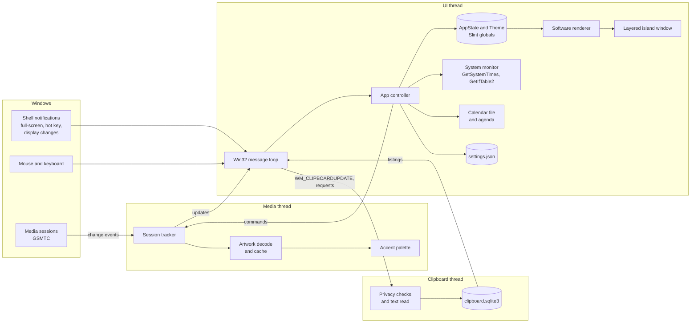

# Architecture

Lilt is a single Windows process with one UI thread and one worker thread. The UI is
written in [Slint](https://slint.dev) and drawn by Slint's software renderer into memory
that Lilt presents with plain Win32 calls; native features are reached through
[`windows-rs`](https://github.com/microsoft/windows-rs). The reasoning behind these
choices, with measurements, is in [docs/framework-evaluation.md](docs/framework-evaluation.md).

## Threads and data flow

**UI thread.** Runs the message loop, every Slint timer, rendering, the system monitor,
calendar parsing and settings. It sleeps in `MsgWaitForMultipleObjectsEx` until input
arrives, a timer is due, another thread posts work, or an animation needs its next
frame. Nothing ticks while the island is idle.

**Media thread.** Owns the Global System Media Transport Controls session manager.
WinRT raises change events on thread-pool threads; their handlers only send a message
to this thread, which reads the new state, decodes artwork, extracts its palette and
posts the result to the UI thread. Between events it blocks on a channel.

**Controls thread.** Started the first time a quick-control pop-up opens. It owns the
Native Wifi handle (whose notifications arrive on Windows thread-pool threads and are
forwarded to it), and makes every call for the pop-ups: radios, Wi-Fi networks and
connections, paired Bluetooth devices (`Windows.Devices.Enumeration` association
endpoints), Bluetooth audio connect and disconnect (`KSPROPSETID_BtAudio` one-shot
requests to the driver behind the device's audio endpoint), volume (Core Audio) and
brightness (WMI). While a pop-up is open the UI thread asks it to read that pop-up's
state again every 2 to 10 seconds; when the pop-up closes, nothing runs.

**Clipboard thread.** Started the first time the clipboard shelf is shown or capture is
turned on. It owns the clipboard database. While capture is on, the control window is
registered with `AddClipboardFormatListener`; each `WM_CLIPBOARDUPDATE` only sends a
message to this thread, which waits 150 ms for the copying app to finish, compares the
clipboard sequence number with the last one seen (so Lilt's own copies and repeated
notifications are skipped), checks the privacy formats and the copying app, reads the
text, classifies it and stores it. Searches, copies back to the clipboard and edits run
here too, so the UI thread never waits on the clipboard or the disk. Between messages
it blocks on a channel, waking hourly to apply the retention period.

There is no async runtime: the few WinRT operations are awaited synchronously on the
media thread.

## Source layout

| Path | Responsibility |
| --- | --- |
| `src/main.rs` | Logging, single-instance guard, start-up |
| `src/window/` | The Slint platform: event loop, Win32 windows, input translation, monitor placement, the glass blur |
| `src/appearance.rs` | Which material the selected appearance uses on this PC |
| `src/app/` | The controller connecting services, settings and UI (`media`, `system`, `calendar`, `preferences`) |
| `src/media/` | Media session tracking, session selection policy and transport commands |
| `src/artwork/` | Artwork decoding, cropping, rounding and caching |
| `src/ambient/` | Colour science (OKLab/OKLCH, contrast) and palette extraction |
| `src/system/` | CPU, memory and network readings and the sampling policy |
| `src/calendar/` | ICS parsing, recurrence expansion, time zones and the agenda |
| `src/tasks/` | The task model, priority ordering, labels and the SQLite store with migrations |
| `src/app/tasks.rs` | The tasks box's controller: list and archive rows, quick entry, completion and undo |
| `src/settings/` | Versioned settings document, validation, migration and atomic saving |
| `src/clock.rs`, `src/hotkey.rs`, `src/startup.rs`, `src/actions.rs`, `src/dialogs.rs` | Clock text, global shortcut, start-with-Windows, quick actions, file dialog |
| `src/fonts.rs` | Registers the bundled fonts with Slint at start-up |
| `src/controls/` | The quick-control pop-ups' Windows calls: Wi-Fi, radios, Bluetooth, audio, brightness, and their worker thread |
| `src/app/controls.rs` | The pop-ups' controller: opening, refreshing, actions |
| `src/clipboard/` | The clipboard shelf: classification and secret checks, capture (`capture.rs`), the SQLite store and the worker thread |
| `src/app/clipboard.rs` | The shelf's controller: listing, selection, copy back, snippets and capture settings |
| `src/snapshots.rs` | Headless UI tests |
| `ui/` | Slint markup: design tokens, island, views, settings window, tray |
| `benchmarks/` | Process-tree resource measurement |
| `tools/media-session/` | A silent test media session for development |

## The window platform

Slint normally renders through a windowing backend. Lilt instead implements Slint's
`Platform` and `WindowAdapter` traits directly (`src/window/`):

- **Island.** A `WS_EX_LAYERED | WS_EX_TOPMOST | WS_EX_TOOLWINDOW | WS_EX_NOACTIVATE`
  popup. Slint renders premultiplied BGRA pixels straight into a DIB section, which is
  presented with `UpdateLayeredWindowIndirect`, passing only the changed rectangle. Fully
  transparent pixels pass mouse input through to the windows underneath, so the window
  can be sized for the largest state without blocking anything. Clicking does not take
  focus; expanding the island takes it explicitly so Escape and outside clicks work, and
  collapsing returns it.
- **Settings window.** An ordinary top-level window that blits the same kind of buffer
  in `WM_PAINT`, with a dark title bar. It is created when opened and destroyed when
  closed.
- **Control window.** A hidden top-level window that receives cross-thread wake-ups,
  the global hot key, the shell's full-screen notifications, display and setting
  changes, and the "show yourself" message from a second instance.
- **DPI.** The process is per-monitor DPI aware (manifest, with a runtime fallback).
  Each window tells Slint its scale factor as soon as it is created (Slint otherwise
  assumes 1), and again from the window's own DPI once it exists; `WM_DPICHANGED`
  updates the scale factor and the window size. Pointer positions are converted with the
  same scale, so what is drawn and what is hit agree at every display scaling.

## Placement

`src/window/placement.rs` enumerates monitors with their work areas and effective DPI.
The island's position is stored as a monitor device name, a horizontal offset from the
work area's centre and a top margin, all in logical pixels, so it survives resolution
and scaling changes. It is recomputed on display, work-area and DPI changes. Dragging
uses the native move loop with the top edge held fixed.

## Update policies

| Data | Mechanism |
| --- | --- |
| Clock | One timer aimed at the next minute boundary; also refreshed on time, time-zone and regional-format changes and on resume |
| Media metadata and playback state | WinRT change events, coalesced for 150 ms; commands run immediately |
| Artwork | Read only when the track changes (or, if it had none, when its properties change); decoded once and cached by content hash |
| Accent palette | Computed once per new artwork on the media thread |
| Playback progress | Extrapolated from the session timeline; refreshed once a second only while expanded and playing |
| Playing bars | A Slint timer steps them about 14 times a second (no per-frame animation) while media plays, the compact island is on screen and motion is not reduced; stopped otherwise |
| CPU / memory / network | 2 s / 5 s / 1 s, only while the expanded island is visible; 5 s / 10 s / 5 s in low-power mode; off otherwise |
| Calendar | Rebuilt when the island expands and each minute while expanded; the file is re-read only if its modification time changed |
| Tasks | The database is opened when the tasks box is first shown; active tasks are kept in memory and the list is rebuilt after each change and each minute while visible; the archive is queried only when shown |
| Full-screen state | Shell app-bar notification, plus one query at start-up |

## Media session selection

When several applications expose sessions, Lilt keeps following the session it shows
until it closes, the user picks another source, or another session *starts* playing.
It never switches because the followed session was paused, which would make the next
click on the same button control a different application. The policy is a pure function
(`media::session::choose`) with unit tests.

## Ambient colour

Artwork is reduced to 32 × 32 pixels and grouped with median cut. Candidates are scored
by how vivid and how common they are, de-emphasising near-black and near-white areas.
The winning hue is kept while lightness and chroma are clamped in OKLCH, and the accent
is lightened until it reaches 4.5:1 contrast with the island surface. The UI uses it for
a radial glow behind the artwork, a faint tint of the expanded surface and accents, and
cross-fades to new colours over 700 ms; otherwise nothing moves except the playing bars.

The software renderer draws gradients and clipped children as rectangles, ignoring
corner radii. Effects are therefore kept inside the rounded shape: the glow fades out
before the panel's edge, the tint is a solid colour of the panel itself, and album
artwork has its rounded corners applied to the pixels when it is decoded.

## Design tokens and appearances

All colours, sizes, radii, type sizes and durations come from the `Theme` global in
`ui/theme.slint`. The values that differ between appearances form one struct,
`AppearanceTokens` (surfaces, secondary surfaces, text, borders, shadows, reflections,
radii, motion and the settings window's colours). Each appearance is one value of it:
`Theme.midnight`, `Theme.smoked-glass` and `Theme.liquid-glass`. `Theme.appearance`
selects one, and every
other token is derived from the selection, so components never know which appearance
is active. Adding an appearance means one more enum variant and one more token value.

### Typography

Body and interface text is DM Sans in every appearance. Headings use the appearance's
display face through two tokens: `display-*` for short, prominent headings (the
`Heading` component in `ui/components/heading.slint`) and `title-*` for longer ones
such as empty-state titles (`Title`). Midnight uses Space Grotesk, Smoked Glass
Instrument Serif, and Liquid Glass Allura for short headings only, with DM Sans for
titles. Each face carries a scale so that it looks as large as DM Sans at the same
nominal size (Allura's lowercase is small, so it is drawn 1.6 times larger). JetBrains
Mono (`Theme.code-font`) is for code and commands.

The five fonts are compiled into the executable with `include_bytes!` and registered
with Slint's font collection when the platform is set (`src/fonts.rs`), so the software
renderer draws them as outlines at any size and display scale. They are deliberately
not imported in `.slint` files: for the software renderer that pre-renders bitmaps at
the sizes written in the markup, which cannot follow computed sizes or display scaling.

Switching is a property change: Slint re-renders what changed, the island's surface
cross-fades over the ambient duration (instant with reduced motion), and no window is
recreated. Midnight's token values are the original values; the UI tests check that
switching to either glass appearance and back restores every pixel.

The glass appearances choose one of two materials (`src/appearance.rs`, a pure function
of the settings and the Windows environment):

- **Live blur** when Windows' *Transparency effects* are on, battery saver and Lilt's
  low-power mode are off, *Reduce transparency* is off, and Windows is 10 1903 or later.
  Surfaces are translucent over the blurred desktop.
- **Frosted** otherwise: denser translucent surfaces that need no blur. Settings shows
  the reason.

The material is re-evaluated when Windows broadcasts a colour or transparency change
(`ImmersiveColorSet`) or a power status change.

### The glass blur

DWM's materials (acrylic, Mica, the undocumented accent blur) fill a window's whole
rectangle and ignore window regions, so they cannot follow the island's pill shape, and
the host backdrop brush of Windows.UI.Composition is not drawn behind windows that never
take the focus (an earlier version used one in a second window under the island; on
real desktops it showed black). Lilt therefore draws the blur itself, inside the
island's own layered window:

- `src/window/sample.rs` reads the screen under the island window with `StretchBlt`
  (halftone) at a resolution that suits the blur `appearance::blur_radius` asks for
  (40 px at 0 % transparency, 20 px at 50 %, none at 100 %): reduced up to eight times
  in each direction for heavy blurs, full resolution for clear glass. Windows includes
  layered windows in screen reads, so the island is excluded from capture
  (`WDA_EXCLUDEFROMCAPTURE`) for the one compositor frame of the read (`DwmFlush`).
  Three passes of a running-sum box blur over the image approximate a Gaussian.
- `src/window/glass.rs` blends it, stretched bilinearly over the window, beneath the
  translucent pixels of the island's surfaces after Slint renders each frame, only
  inside their rounded outlines and with antialiased edges. Liquid Glass bends it within
  a band about as wide as the corner radius: each pixel there samples further out along
  the outline's normal, most at the edge, so the desktop is drawn in towards the edge as
  through a thick lens. Shadows and the transparent surroundings are left alone.
- `src/app/glass.rs` decides when to read the screen: after the island appears, opens,
  closes or is moved; 300 ms after another window comes to the front, finishes moving or
  scrolling, or is restored (an out-of-context `SetWinEventHook`, removed when not
  needed); after a wallpaper change; and every 3 s while the island is open. Only that
  image is kept, in memory.

### Tint and transparency

The glass tints over the blur are `Theme.smoked-alpha` and `Theme.glass-alpha`.
`appearance::preferred_alpha` turns the *Glass transparency* setting into an opacity
(50 % is each appearance as designed: 84 % for Smoked Glass, 36 % for Liquid Glass), and
`appearance::legible_alpha` raises it, up to 86 %, until the text reaches
`appearance::contrast_targets` over the brightest 16-pixel area of the backdrop, on the
glass and on its tiles: WCAG AA (4.5:1 for primary and secondary text, 3:1 for tertiary)
up to 50 % transparency, easing to 2:1, 1.6:1 and 1.3:1 at 100 % so that clear glass
stays clear. The island's background animation cross-fades the change.

On Windows 11 22H2 and later the settings window uses the documented system acrylic
(`DWMWA_SYSTEMBACKDROP_TYPE`) with its frame extended over the client area; Lilt's
premultiplied pixels are copied with their alpha, so translucent surfaces composite
over it.

### Reflections

Slint's software renderer draws gradients as rectangles and draws a clipping
rectangle's border over its children. The glass's light is therefore built from shapes
the renderer draws exactly: the sheen is a radial gradient centred above the surface
that fades out before it can reach the rounded corners, and the rim is the surface's own
rounded outline, drawn over it and clipped to the band above the straight sides.
Liquid Glass adds a fainter rim clipped to the band below them.

## Persistence and files

| File | Location | Written |
| --- | --- | --- |
| Settings | `%APPDATA%\Lilt\settings.json` | Shortly after a change, atomically; never on start-up |
| Log | `%LOCALAPPDATA%\Lilt\logs\lilt.log` | On notable events; rotated at 512 KB |
| Tasks | `%LOCALAPPDATA%\Lilt\tasks.sqlite3` | On each change, in a transaction (SQLite, write-ahead log) |
| Clipboard shelf | `%LOCALAPPDATA%\Lilt\clipboard.sqlite3` | On each kept copy or edit, on the clipboard thread (write-ahead log, `secure_delete`) |
| Start with Windows | `HKCU\Software\Microsoft\Windows\CurrentVersion\Run\Lilt` | When toggled |

## Testing

- Unit tests cover parsing, colour extraction, date arithmetic, time-zone conversion,
  settings validation and migration, placement geometry, shortcut handling and the
  session selection policy.
- `src/snapshots.rs` renders the real UI components headlessly with a controllable clock
  and checks layout, artwork, ambient colours and scaling; images are written to
  `target/ui-snapshots/`.
- The clipboard store is tested for de-duplication, exact Unicode round trips, search
  (any part, any language), ordering, retention, limits and that deleted text no
  longer appears in the database files; classification and the secret checks have
  their own cases. Two tests that use the real clipboard (privacy formats, own copies)
  run only on request: `cargo test -- --ignored clipboard::capture`.
- `tools/media-session` provides a deterministic media session for manual and benchmark
  runs, and `benchmarks/` measures the running application.
