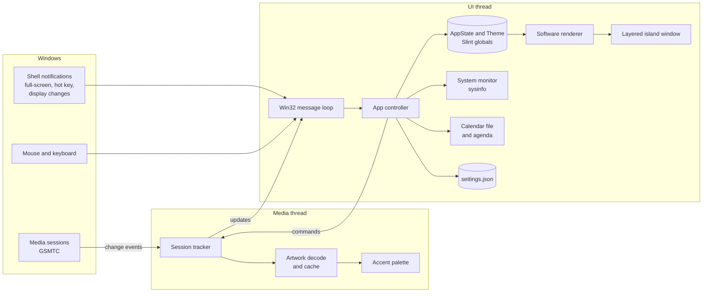

# Architecture

Lilt is a single Windows process with one UI thread and one worker thread. The UI is
written in [Slint](https://slint.dev) and drawn by Slint's software renderer into memory
that Lilt presents with plain Win32 calls; native features are reached through
[`windows-rs`](https://github.com/microsoft/windows-rs). The reasoning behind these
choices, with measurements, is in [docs/framework-evaluation.md](docs/framework-evaluation.md).

## Threads and data flow

**UI thread.** Runs the message loop, every Slint timer, rendering, the system monitor,
calendar parsing and settings. It sleeps in `MsgWaitForMultipleObjectsEx` until input
arrives, a timer is due, another thread posts work, or an animation needs its next
frame. Nothing ticks while the island is idle.

**Media thread.** Owns the Global System Media Transport Controls session manager.
WinRT raises change events on thread-pool threads; their handlers only send a message
to this thread, which reads the new state, decodes artwork, extracts its palette and
posts the result to the UI thread. Between events it blocks on a channel.

There is no async runtime: the few WinRT operations are awaited synchronously on the
media thread.

## Source layout

| Path | Responsibility |
| --- | --- |
| `src/main.rs` | Logging, single-instance guard, start-up |
| `src/window/` | The Slint platform: event loop, Win32 windows, input translation, monitor placement, the Liquid Glass backdrop |
| `src/appearance.rs` | Which material the selected appearance uses on this PC |
| `src/app/` | The controller connecting services, settings and UI (`media`, `system`, `calendar`, `preferences`) |
| `src/media/` | Media session tracking, session selection policy and transport commands |
| `src/artwork/` | Artwork decoding, cropping, rounding and caching |
| `src/ambient/` | Colour science (OKLab/OKLCH, contrast) and palette extraction |
| `src/system/` | CPU, memory and network readings and the sampling policy |
| `src/calendar/` | ICS parsing, recurrence expansion, time zones and the agenda |
| `src/settings/` | Versioned settings document, validation, migration and atomic saving |
| `src/clock.rs`, `src/hotkey.rs`, `src/startup.rs`, `src/actions.rs`, `src/dialogs.rs` | Clock text, global shortcut, start-with-Windows, quick actions, file dialog |
| `src/snapshots.rs` | Headless UI tests |
| `ui/` | Slint markup: design tokens, island, views, settings window, tray |
| `benchmarks/` | Process-tree resource measurement |
| `tools/media-session/` | A silent test media session for development |

## The window platform

Slint normally renders through a windowing backend. Lilt instead implements Slint's
`Platform` and `WindowAdapter` traits directly (`src/window/`):

- **Island.** A `WS_EX_LAYERED | WS_EX_TOPMOST | WS_EX_TOOLWINDOW | WS_EX_NOACTIVATE`
  popup. Slint renders premultiplied BGRA pixels straight into a DIB section, which is
  presented with `UpdateLayeredWindowIndirect`, passing only the changed rectangle. Fully
  transparent pixels pass mouse input through to the windows underneath, so the window
  can be sized for the largest state without blocking anything. Clicking does not take
  focus; expanding the island takes it explicitly so Escape and outside clicks work, and
  collapsing returns it.
- **Settings window.** An ordinary top-level window that blits the same kind of buffer
  in `WM_PAINT`, with a dark title bar. It is created when opened and destroyed when
  closed.
- **Control window.** A hidden top-level window that receives cross-thread wake-ups,
  the global hot key, the shell's full-screen notifications, display and setting
  changes, and the "show yourself" message from a second instance.
- **DPI.** The process is per-monitor DPI aware (manifest, with a runtime fallback).
  `WM_DPICHANGED` updates Slint's scale factor and the window size.

## Placement

`src/window/placement.rs` enumerates monitors with their work areas and effective DPI.
The island's position is stored as a monitor device name, a horizontal offset from the
work area's centre and a top margin, all in logical pixels, so it survives resolution
and scaling changes. It is recomputed on display, work-area and DPI changes. Dragging
uses the native move loop with the top edge held fixed.

## Update policies

| Data | Mechanism |
| --- | --- |
| Clock | One timer aimed at the next minute boundary; also refreshed on time, time-zone and regional-format changes and on resume |
| Media metadata and playback state | WinRT change events, coalesced for 150 ms; commands run immediately |
| Artwork | Read only when the track changes (or, if it had none, when its properties change); decoded once and cached by content hash |
| Accent palette | Computed once per new artwork on the media thread |
| Playback progress | Extrapolated from the session timeline; refreshed once a second only while expanded and playing |
| Playing bars | A Slint timer steps them about 14 times a second (no per-frame animation) while media plays, the compact island is on screen and motion is not reduced; stopped otherwise |
| CPU / memory / network | 2 s / 5 s / 1 s, only while the expanded island is visible; 5 s / 10 s / 5 s in low-power mode; off otherwise |
| Calendar | Rebuilt when the island expands and each minute while expanded; the file is re-read only if its modification time changed |
| Full-screen state | Shell app-bar notification, plus one query at start-up |

## Media session selection

When several applications expose sessions, Lilt keeps following the session it shows
until it closes, the user picks another source, or another session *starts* playing.
It never switches because the followed session was paused, which would make the next
click on the same button control a different application. The policy is a pure function
(`media::session::choose`) with unit tests.

## Ambient colour

Artwork is reduced to 32 × 32 pixels and grouped with median cut. Candidates are scored
by how vivid and how common they are, de-emphasising near-black and near-white areas.
The winning hue is kept while lightness and chroma are clamped in OKLCH, and the accent
is lightened until it reaches 4.5:1 contrast with the island surface. The UI uses it for
a radial glow behind the artwork, a faint tint of the expanded surface and accents, and
cross-fades to new colours over 700 ms; otherwise nothing moves except the playing bars.

The software renderer draws gradients and clipped children as rectangles, ignoring
corner radii. Effects are therefore kept inside the rounded shape: the glow fades out
before the panel's edge, the tint is a solid colour of the panel itself, and album
artwork has its rounded corners applied to the pixels when it is decoded.

## Design tokens and appearances

All colours, sizes, radii, type sizes and durations come from the `Theme` global in
`ui/theme.slint`. The values that differ between appearances form one struct,
`AppearanceTokens` (surfaces, secondary surfaces, text, borders, shadows, reflections,
radii, motion and the settings window's colours). Each appearance is one value of it:
`Theme.midnight` and `Theme.liquid-glass`. `Theme.appearance` selects one, and every
other token is derived from the selection, so components never know which appearance
is active. Adding an appearance means one more enum variant and one more token value.

Switching is a property change: Slint re-renders what changed, the island's surface
cross-fades over the ambient duration (instant with reduced motion), and no window is
recreated. Midnight's token values are the original values; the UI tests check that
switching to Liquid Glass and back restores every pixel.

Liquid Glass chooses one of two materials (`src/appearance.rs`, a pure function of the
settings and the Windows environment):

- **Live blur** when Windows' *Transparency effects* are on, battery saver and Lilt's
  low-power mode are off, *Reduce transparency* is off, and Windows is 10 1903 or later.
  Surfaces are translucent over the blurred desktop.
- **Frosted** otherwise: denser translucent surfaces that need no blur. Settings shows
  the reason.

The material is re-evaluated when Windows broadcasts a colour or transparency change
(`ImmersiveColorSet`) or a power status change.

### The live blur

DWM's materials (acrylic, Mica, the undocumented accent blur) fill a window's whole
rectangle and ignore window regions, so they cannot follow the island's pill shape;
this was verified with a prototype before choosing the design. Instead
`src/window/backdrop.rs` creates a second window directly beneath the island:

- layered and `WS_EX_TRANSPARENT`, so it never receives input and the island's
  transparent surroundings still let clicks through;
- `WS_EX_NOREDIRECTIONBITMAP`, hosting one Windows.UI.Composition sprite visual whose
  brush is the host backdrop (the desktop behind the window, blurred by DWM) and whose
  clip is a rounded rectangle;
- moved, shown, hidden and re-stacked with the island on every `WM_WINDOWPOSCHANGED`,
  and given the island's current outline after every frame Lilt renders, so the clip
  follows size animations.

The compositor and its dispatcher queue are created on first use and kept for the life
of the UI thread. Midnight and the frosted material never create them.

On Windows 11 22H2 and later the settings window uses the documented system acrylic
(`DWMWA_SYSTEMBACKDROP_TYPE`) with its frame extended over the client area; Lilt's
premultiplied pixels are copied with their alpha, so translucent surfaces composite
over it.

### Reflections

Slint's software renderer draws gradients as rectangles and draws a clipping
rectangle's border over its children. Liquid Glass's light is therefore built from
shapes the renderer draws exactly: the sheen is a radial gradient centred above the
surface that fades out before it can reach the rounded corners, and the rim is the
surface's own rounded outline, drawn over it and clipped to the band above the straight
sides.

## Persistence and files

| File | Location | Written |
| --- | --- | --- |
| Settings | `%APPDATA%\Lilt\settings.json` | Shortly after a change, atomically; never on start-up |
| Log | `%LOCALAPPDATA%\Lilt\logs\lilt.log` | On notable events; rotated at 512 KB |
| Start with Windows | `HKCU\Software\Microsoft\Windows\CurrentVersion\Run\Lilt` | When toggled |

## Testing

- Unit tests cover parsing, colour extraction, date arithmetic, time-zone conversion,
  settings validation and migration, placement geometry, shortcut handling and the
  session selection policy.
- `src/snapshots.rs` renders the real UI components headlessly with a controllable clock
  and checks layout, artwork, ambient colours and scaling; images are written to
  `target/ui-snapshots/`.
- `tools/media-session` provides a deterministic media session for manual and benchmark
  runs, and `benchmarks/` measures the running application.
