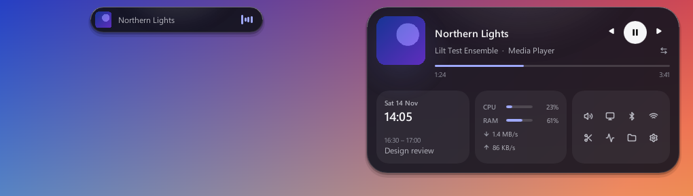

<p align="center">
  
</p>

<h1 align="center">Lilt</h1>

<p align="center"><em>A little more, at a glance.</em></p>

Lilt is a lightweight, Dynamic Island-style companion for Windows. A small capsule sits
at the top of your screen showing the time or what's playing; click it and it opens
into a compact dashboard with music controls, album artwork, your agenda, system
readings and quick actions. It is built to stay out of the way: idle, it uses a few
megabytes of memory and no measurable CPU or GPU time.


<sub>Images are rendered from Lilt's real interface by its UI test suite.</sub>

## Features

- **The island.** A capsule at the top centre of the display you choose.
  It stays above other windows without taking focus, lets clicks pass through its
  transparent surroundings, can be dragged along the top edge, follows display and
  scaling changes, and hides while a game, video or presentation is full screen.
- **Music controls.** Works with any app that reports to Windows' media controls, such
  as Spotify, web browsers and the Windows Media Player app: title, artist, album artwork,
  play/pause, previous/next, seeking and a source switcher. A short banner announces
  new tracks.
- **Three appearances.** *Midnight*, the original minimal near-black look; *Smoked
  Glass*, dark smoked glass with a lit rim over a blur of the desktop; and *Liquid
  Glass*, clear glass lit along both edges that lets the desktop's colour through and
  darkens only as much as a bright window behind it requires. A slider sets how
  transparent the glass is. Switch instantly in Settings.
- **Ambient colour.** The expanded player picks up a restrained accent from the current
  album artwork: a soft glow behind the cover, a faint tint of the panel and an
  accent-coloured progress bar. Intensity is adjustable and it can be turned off.
- **Agenda.** Import an `.ics` file exported from Outlook, Google Calendar or Apple
  Calendar to see the week ahead, including recurring events and time zones.
- **System readings.** CPU and memory use and network throughput, sampled only while
  you are looking at them.
- **Tasks.** A prioritised task list in its own box beside or below the expanded island:
  quick entry, priorities from Critical to none, due dates and times, a "Focus now" task,
  a satisfying tick with undo, and a searchable archive of completed work. Tasks are
  stored on this PC.
- **Clipboard shelf.** Copied text you can search and copy again, pinned entries and
  snippets you save by hand, in the box next to the expanded island. Remembering copied
  text is optional and off until you turn it on; it skips likely passwords and keys and
  copies from password managers, and everything stays on this PC.
- **Quick controls.** Volume, brightness, Bluetooth and Wi-Fi open small pop-ups in the
  island: change the volume or mute, adjust each open app's volume, set the screen's
  brightness, turn Bluetooth or Wi-Fi on and off, connect to a network (typing its
  password if it is new), and connect or disconnect Bluetooth headphones and speakers.
  The other buttons open Windows Settings, the Snipping Tool, Task Manager and File
  Explorer.
- **Settings.** Appearance, widgets, sizes, display and position, ambient colour,
  motion, a low-power mode, start with Windows and a global shortcut.
- **Updates.** Lilt checks stable GitHub releases at startup. When a newer release is
  available, it downloads, verifies and installs it; the updated app starts the next
  time you open Lilt.

## Installation

1. Open the [latest release](https://github.com/shrenixcodes/Lilt/releases/latest).
2. Download `Lilt-<version>-x64-setup.exe`.
3. Run it. It installs for your user account only and does not need administrator
   rights. Optionally choose to start Lilt when you sign in.
4. Lilt starts after installation and adds an icon to the notification area.

Each release lists the installer's SHA-256 checksum. The installer is not yet code
signed, so Windows SmartScreen may ask you to confirm the first time ("More info" →
"Run anyway").

To uninstall, use *Settings → Apps → Installed apps → Lilt*.

### Updates

Lilt checks for a newer stable release when it starts. If one is available, it downloads
the installer in the background, verifies its SHA-256 checksum from GitHub's release
asset metadata, and runs it. The installer replaces the app for your user account; the
new version is used the next time Lilt starts. Manual and periodic checks only tell you
that an update is available, so they never interrupt your work.

### System requirements

- Windows 11, 64-bit. Windows 10 version 22H2 is intended to work but has not been
  verified yet.
- No additional runtimes: Lilt does not use .NET, a web view or the Visual C++
  redistributable.
- Runs on integrated graphics. Lilt draws on the CPU, including the glass appearances'
  backdrop, which it computes from a copy of the screen behind the island.

## Using Lilt

| To | Do |
| --- | --- |
| Expand or collapse the island | Click it, or press **Ctrl+Alt+Space** |
| Close the expanded island | **Esc**, click elsewhere, or move the pointer away for a few seconds |
| Move the island | Drag the compact island sideways |
| Open the agenda or system details | Click the calendar or system tile |
| Add a task | Expand the island, then press **N** or click **+** in the tasks box |
| Complete, edit or postpone a task | Click its circle; click the task; hover and click the clock |
| Move the tasks box | Click the layout button in its header, or *Settings → Widgets* |
| Show or hide the island, open Settings, quit | Use the Lilt icon in the notification area |

### Appearances

Choose an appearance in *Settings → Appearance & position*; the island, the music player, the
dashboard tiles, track banners and the settings window change at once.

- **Midnight** is the original appearance: near-black solid surfaces and quiet borders.
- **Smoked Glass** is dark smoked glass with a lit upper rim.
- **Liquid Glass** is clear glass with light along its upper and lower edges. Over dark
  content the tint is light and the desktop's colours show through.

Each appearance has its own heading face; everything else is set in DM Sans:
Space Grotesk in Midnight, Instrument Serif in Smoked Glass and the script Allura in
Liquid Glass, used only for short headings such as "Tasks" (longer titles stay in DM
Sans). Code and commands use JetBrains Mono. The fonts are bundled with Lilt under the
SIL Open Font License, so nothing is downloaded and the look is the same on every PC.

Behind both glass appearances Lilt shows the desktop. **Glass transparency** (0–100 %,
default 50 %) sets how: a heavy blur at 0 %, a frosted blur at 50 % and clear glass at
100 %, where the desktop shows through sharply and Liquid Glass bends it along its edges
like a thick lens. Lilt reads the screen behind the island, at a resolution that suits
the blur, when the island opens, closes or moves, when another window comes to the
front, moves or scrolls, and every 3 seconds while the island is open.

Up to 50 % the tint deepens over bright windows just enough to keep text at WCAG AA
contrast (4.5:1). Above that, clarity wins progressively: at 100 % the glass dims only
lightly, keeping at least 2:1, so text can be harder to read over very bright windows.

On Windows 11 22H2 and later the settings window uses the system acrylic. When Windows'
*Transparency effects* are off, battery saver or Lilt's low-power mode is on, or you turn
on *Reduce transparency*, the glass keeps its look with frosted surfaces instead of the
blur, and Settings says why.




### Music

Lilt follows the app that last started playing. Pausing never makes it jump to a
different app, so the same button keeps controlling the same music. When several apps
are available, the ⇄ button next to the source name switches between them. Controls
an app does not support are shown disabled, and the progress bar appears only when
the app reports a timeline.

### Ambient colours

Each new cover is reduced to a few dozen pixels and grouped into colour clusters. Lilt
picks the most characteristic colour, keeps its hue and tones it down so text stays
readable (at least 4.5:1 contrast). Greyscale covers get a neutral treatment. Colours
fade over 0.7 seconds when the artwork changes and stay still otherwise.

## Performance

Lilt is a single process with no web view, and it draws on the CPU, the glass blur
included. Timers only run while
their results are on screen, and media updates arrive as Windows events rather than by
polling. Measured on a release build:

| State | Memory (Task Manager) | CPU (all cores) |
| --- | --- | --- |
| Compact, idle (Midnight / Liquid Glass) | 3.0 / 3.2 MB | 0.000 % |
| Compact, music playing, bars moving | 3.5 MB | 0.041 % |
| Expanded with the tasks box, readings live | 3.5–3.6 MB | 0.022–0.047 % |

[PERFORMANCE.md](PERFORMANCE.md) has the full results, the test machine and the method.

### Tasks

Tasks are grouped by priority, from Critical to No priority. Within a priority, overdue
tasks come first, then tasks due today, then the nearest dates, then undated tasks. The
sort button switches to your own order, which you change with the arrows that appear on
hover (or Alt+Up and Alt+Down); a task never moves above one of higher priority. The first
task is shown as *Focus now*.

Completing a task ticks it at once and updates the counts; it leaves the list a moment
later, and **Undo** brings it back. Completed tasks stay in **Done**, grouped by day and
searchable, until you restore or delete them.

### Quick controls

The first row of the quick actions tile opens pop-ups over the expanded island; the
**×** closes them, and the link at the bottom opens the matching page of Windows
Settings for anything more.

- **Volume:** the default output's level and mute.
- **Brightness:** built-in laptop and tablet screens. External monitors usually only
  change brightness with their own buttons, and the pop-up says so.
- **Bluetooth:** the on/off switch and your paired devices with their connection state.
  Headphones and speakers get **Connect** and **Disconnect** when Windows lists their
  Bluetooth audio driver, through the reconnect and disconnect requests that driver
  accepts; otherwise connect them in Windows' settings. Mice, keyboards and similar
  devices connect by themselves when you use them. Pairing a new device happens in
  Windows' settings.
- **Wi-Fi:** the on/off switch and the networks in range, strongest first. Click a saved
  or open network to connect; a new secured network asks for its password, which goes
  straight into a Windows Wi-Fi profile, just as when you join from Windows' own
  flyout. If the connection fails, that profile is removed again. Enterprise networks
  that need a user name are joined in Windows' settings.

If Windows refuses to switch a radio (for example when *Let apps control device radios*
is off in Privacy & security), the pop-up says so.

### Clipboard shelf

The box next to the expanded island shows **Tasks** or **Clipboard**; click the other
name in its title to switch. Turn the shelf on or off in *Settings → Widgets*.

The first time it opens, the shelf asks whether to remember copied text. With capture on,
text you copy in any app appears under *Recent* with the app it came from (when Windows
says) and when; repeated copies move to the top instead of piling up. Click an entry to
copy it back, or use the buttons on hover to pin, edit or delete it. **+** saves a
snippet: text you reuse, with an optional title and description. Pinned entries and
snippets are kept until you delete them; copied text is kept for 30 days by default
(1 day to forever) and up to 500 entries (50 to 5,000).

Search matches any part of the text, a snippet's title or description, or the app.
Filters show pinned entries, recent copies, snippets, links, code (including JSON and
commands) or other text. The arrow keys choose an entry, **Enter** copies it and closes
the island so you can paste straight away, **Delete** removes it and **Ctrl+F** searches.

Pause capture from the shelf's menu or its pause button, turn it off there or in
*Settings → Clipboard*, and clear the history at any time. Settings also has the app
exclusion list, the option to skip copies whose app Windows does not report, the
retention period and size limit, and a global shortcut that opens the shelf. No shortcut
is set by default: the natural choice, Ctrl+Shift+V, is already "paste as plain text" in
browsers and Office and "paste" in Windows Terminal, and Lilt would take it from them.

What is never kept: images, files and other non-text content; copies an app marks as
private (password managers do), copies from excluded apps (several password managers are
excluded by default), and text that looks like a password, private key or access token.
That last check is deliberately cautious, so it can miss some secrets; exclude any app
you copy secrets from.

## Privacy

Lilt has no telemetry or accounts. At startup it asks GitHub for the latest stable
release. If a newer release exists, Lilt downloads the release installer, verifies its
SHA-256 digest supplied by GitHub, and starts that installer; manual and periodic checks
only report availability. These requests send only the usual HTTPS request metadata to
GitHub. Media and calendar information is only displayed, never stored or sent anywhere.
Tasks and the clipboard shelf are stored on this PC only, and copied text is never
logged. Details are in [SECURITY.md](SECURITY.md).

## Troubleshooting

- **No music appears.** The app must use Windows' media controls. Check that the track
  shows up in the volume flyout (Win+A, or the media controls on the lock screen).
- **The shortcut does nothing.** Another app may own it; Lilt says so in
  *Settings → Keyboard shortcuts*, where you can choose another one.
- **The island is gone.** It hides while a full-screen app is in front. Otherwise click
  the notification-area icon, or start Lilt again.
- **Something else.** Logs are in `%LOCALAPPDATA%\Lilt\logs`. Please include them in an
  [issue](https://github.com/shrenixcodes/Lilt/issues).

## Building from source

```powershell
git clone https://github.com/shrenixcodes/Lilt.git
cd Lilt
cargo build --release
```

See [DEVELOPMENT.md](DEVELOPMENT.md) for prerequisites, tests and tooling,
[ARCHITECTURE.md](ARCHITECTURE.md) for how Lilt is put together and
[RELEASE.md](RELEASE.md) for packaging.

## Contributing

Issues and pull requests are welcome. Please keep changes focused, run
`cargo fmt`, `cargo clippy --all-targets -- -D warnings` and `cargo test`, and describe
how you tested. New dependencies need a clear reason; Lilt's resource use is a feature.

## License

Lilt is released under the [MIT License](LICENSE).

Its interface is built with [Slint](https://slint.dev), used under the Slint
Royalty-free License; icons are from [Lucide](https://lucide.dev). See
[THIRD-PARTY-NOTICES.md](THIRD-PARTY-NOTICES.md) for all acknowledgements.

<a href="https://slint.dev"></a>
