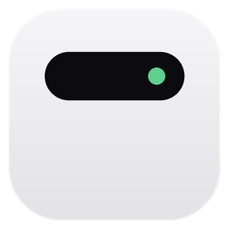
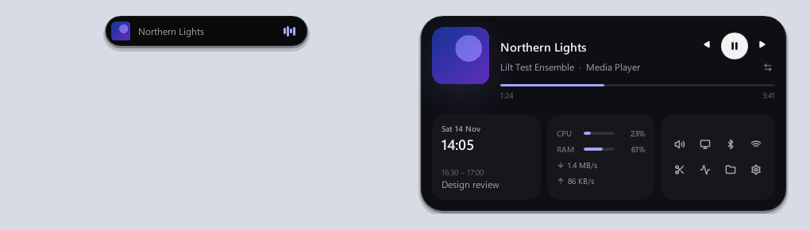
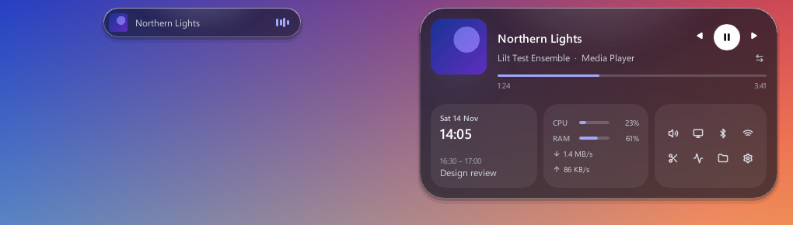

<p align="center">
  
</p>

<h1 align="center">Lilt</h1>

<p align="center"><em>A little more, at a glance.</em></p>

Lilt is a lightweight, Dynamic Island-style companion for Windows. A small capsule sits
at the top of your screen showing the time or what's playing; click it and it opens
into a compact dashboard with music controls, album artwork, your agenda, system
readings and quick actions. It is built to stay out of the way: idle, it uses a few
megabytes of memory and no measurable CPU or GPU time.



<sub>Images are rendered from Lilt's real interface by its UI test suite.</sub>

## Features

- **The island.** A capsule at the top centre of the display you choose.
  It stays above other windows without taking focus, lets clicks pass through its
  transparent surroundings, can be dragged along the top edge, follows display and
  scaling changes, and hides while a game, video or presentation is full screen.
- **Music controls.** Works with any app that reports to Windows' media controls, such
  as Spotify, web browsers and the Windows Media Player app: title, artist, album artwork,
  play/pause, previous/next, seeking and a source switcher. A short banner announces
  new tracks.
- **Two appearances.** *Midnight*, the original minimal near-black look, and *Liquid
  Glass*, dark smoked glass with a lit rim and soft reflections over a live blur of the
  desktop. Switch between them instantly in Settings.
- **Ambient colour.** The expanded player picks up a restrained accent from the current
  album artwork: a soft glow behind the cover, a faint tint of the panel and an
  accent-coloured progress bar. Intensity is adjustable and it can be turned off.
- **Agenda.** Import an `.ics` file exported from Outlook, Google Calendar or Apple
  Calendar to see the week ahead, including recurring events and time zones.
- **System readings.** CPU and memory use and network throughput, sampled only while
  you are looking at them.
- **Tasks.** A prioritised task list in its own box beside or below the expanded island:
  quick entry, priorities from Critical to none, due dates and times, a "Focus now" task,
  a satisfying tick with undo, and a searchable archive of completed work. Tasks are
  stored on this PC.
- **Quick actions.** One click to sound, display and brightness, Bluetooth and Wi-Fi
  settings, Windows Settings, the Snipping Tool, Task Manager and File Explorer.
- **Settings.** Appearance, widgets, sizes, display and position, ambient colour,
  motion, a low-power mode, start with Windows and a global shortcut.

## Installation

1. Open the [latest release](https://github.com/shrenixcodes/Lilt/releases/latest).
2. Download `Lilt-<version>-x64-setup.exe`.
3. Run it. It installs for your user account only and does not need administrator
   rights. Optionally choose to start Lilt when you sign in.
4. Lilt starts after installation and adds an icon to the notification area.

Each release lists the installer's SHA-256 checksum. The installer is not yet code
signed, so Windows SmartScreen may ask you to confirm the first time ("More info" →
"Run anyway").

To uninstall, use *Settings → Apps → Installed apps → Lilt*.

### System requirements

- Windows 11, 64-bit. Windows 10 version 22H2 is intended to work but has not been
  verified yet.
- No additional runtimes: Lilt does not use .NET, a web view or the Visual C++
  redistributable.
- Runs on integrated graphics. Lilt draws on the CPU; in Liquid Glass, Windows' own
  compositor blurs the desktop behind the island on the GPU, as it does for the Start
  menu.

## Using Lilt

| To | Do |
| --- | --- |
| Expand or collapse the island | Click it, or press **Ctrl+Alt+Space** |
| Close the expanded island | **Esc**, click elsewhere, or move the pointer away for a few seconds |
| Move the island | Drag the compact island sideways |
| Open the agenda or system details | Click the calendar or system tile |
| Add a task | Expand the island, then press **N** or click **+** in the tasks box |
| Complete, edit or postpone a task | Click its circle; click the task; hover and click the clock |
| Move the tasks box | Click the layout button in its header, or *Settings → Widgets* |
| Show or hide the island, open Settings, quit | Use the Lilt icon in the notification area |

### Appearances

Choose an appearance in *Settings → Appearance & position*; the island, the music player, the
dashboard tiles, track banners and the settings window change at once.

- **Midnight** is the original appearance: near-black solid surfaces and quiet borders.
- **Liquid Glass** is dark smoked glass. Behind the island Windows blurs the desktop,
  and on Windows 11 22H2 and later the settings window uses the system acrylic. When
  Windows' *Transparency effects* are off, battery saver or Lilt's low-power mode is
  on, or you turn on *Reduce transparency*, Liquid Glass keeps its look with frosted
  surfaces instead of a live blur, and Settings says why.



### Music

Lilt follows the app that last started playing. Pausing never makes it jump to a
different app, so the same button keeps controlling the same music. When several apps
are available, the ⇄ button next to the source name switches between them. Controls
an app does not support are shown disabled, and the progress bar appears only when
the app reports a timeline.

### Ambient colours

Each new cover is reduced to a few dozen pixels and grouped into colour clusters. Lilt
picks the most characteristic colour, keeps its hue and tones it down so text stays
readable (at least 4.5:1 contrast). Greyscale covers get a neutral treatment. Colours
fade over 0.7 seconds when the artwork changes and stay still otherwise.

## Performance

Lilt is a single process with no web view, and it draws on the CPU (Liquid Glass's live
blur is drawn by Windows' compositor). Timers only run while
their results are on screen, and media updates arrive as Windows events rather than by
polling. Measured on a release build:

| State | Memory (Task Manager) | CPU (all cores) |
| --- | --- | --- |
| Compact, idle | 6.3 MB | 0.000 % |
| Expanded, readings live | 6.4 MB | 0.001 % |
| Expanding and collapsing every 2 s | 6.5 MB | 0.021 % |

These were measured with Midnight; Liquid Glass has not been benchmarked side by side yet.

[PERFORMANCE.md](PERFORMANCE.md) has the full results, the test machine and the method.

### Tasks

Tasks are grouped by priority, from Critical to No priority. Within a priority, overdue
tasks come first, then tasks due today, then the nearest dates, then undated tasks. The
sort button switches to your own order, which you change with the arrows that appear on
hover (or Alt+Up and Alt+Down); a task never moves above one of higher priority. The first
task is shown as *Focus now*.

Completing a task ticks it at once and updates the counts; it leaves the list a moment
later, and **Undo** brings it back. Completed tasks stay in **Done**, grouped by day and
searchable, until you restore or delete them.

## Privacy

Lilt works entirely offline: no telemetry, no update checks, no accounts. Media and
calendar information is only displayed, never stored or sent anywhere. Details are in
[SECURITY.md](SECURITY.md).

## Troubleshooting

- **No music appears.** The app must use Windows' media controls. Check that the track
  shows up in the volume flyout (Win+A, or the media controls on the lock screen).
- **The shortcut does nothing.** Another app may own it; Lilt says so in
  *Settings → Keyboard shortcuts*, where you can choose another one.
- **The island is gone.** It hides while a full-screen app is in front. Otherwise click
  the notification-area icon, or start Lilt again.
- **Something else.** Logs are in `%LOCALAPPDATA%\Lilt\logs`. Please include them in an
  [issue](https://github.com/shrenixcodes/Lilt/issues).

## Building from source

```powershell
git clone https://github.com/shrenixcodes/Lilt.git
cd Lilt
cargo build --release
```

See [DEVELOPMENT.md](DEVELOPMENT.md) for prerequisites, tests and tooling,
[ARCHITECTURE.md](ARCHITECTURE.md) for how Lilt is put together and
[RELEASE.md](RELEASE.md) for packaging.

## Contributing

Issues and pull requests are welcome. Please keep changes focused, run
`cargo fmt`, `cargo clippy --all-targets -- -D warnings` and `cargo test`, and describe
how you tested. New dependencies need a clear reason; Lilt's resource use is a feature.

## License

Lilt is released under the [MIT License](LICENSE).

Its interface is built with [Slint](https://slint.dev), used under the Slint
Royalty-free License; icons are from [Lucide](https://lucide.dev). See
[THIRD-PARTY-NOTICES.md](THIRD-PARTY-NOTICES.md) for all acknowledgements.

<a href="https://slint.dev"></a>
