<p align="center">
  
</p>

<h1 align="center">Lilt</h1>

<p align="center"><em>A little more, at a glance.</em></p>

<p align="center">
  <a href="https://github.com/shrenixcodes/Lilt/releases/latest"></a>
  
  
  
  
</p>

---

Lilt is a lightweight, Dynamic Island-style desktop companion for Windows. A small capsule sits at the top of your screen showing the time or what's playing. Click it and it expands into a compact dashboard: music controls with artwork, your calendar agenda, live system readings and quick toggles for sound, brightness, Bluetooth and Wi-Fi. A side panel shows your task list or clipboard history. It is built to disappear when you are not looking at it — idle, it uses a few megabytes of memory and no measurable CPU or GPU time.

<p align="center">
  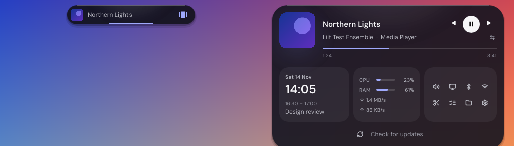
</p>
<p align="center"><sub>Compact island (left) and expanded dashboard (right) — Smoked Glass appearance over a colourful wallpaper.</sub></p>

---

## Contents

- [Appearances](#appearances)
- [Features](#features)
  - [Music](#music)
  - [Agenda](#agenda)
  - [System readings](#system-readings)
  - [Tasks](#tasks)
  - [Clipboard shelf](#clipboard-shelf)
  - [Quick controls](#quick-controls)
  - [Settings](#settings)
- [Performance](#performance)
- [Installation](#installation)
- [Usage](#usage)
- [Building from source](#building-from-source)
- [Architecture](#architecture)
- [Roadmap](#roadmap)
- [Contributing](#contributing)
- [License](#license)

---

## Appearances

Lilt ships with three appearances. Switch between them instantly in **Settings → Appearance & position**.

<table>
<tr>
<td align="center" width="33%">
<br>
<strong>Smoked Glass</strong><br>
<sub>Dark smoked glass with a lit upper rim. Blurs the desktop behind it.</sub>
</td>
<td align="center" width="33%">
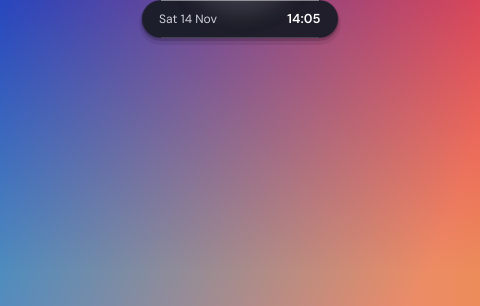<br>
<strong>Liquid Glass</strong><br>
<sub>Clear glass that bends light at its edges. Darkens only as much as bright content requires.</sub>
</td>
<td align="center" width="34%">
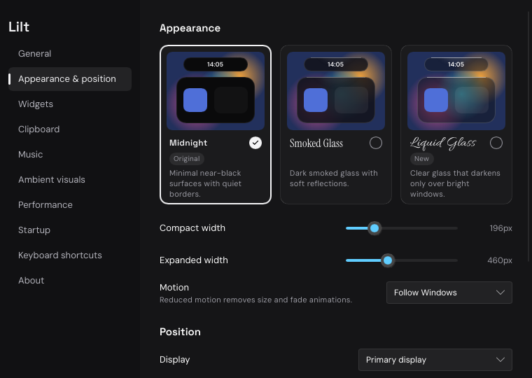<br>
<strong>Midnight</strong><br>
<sub>The original look: near-black solid surfaces and quiet borders. Zero extra rendering cost.</sub>
</td>
</tr>
</table>

The two glass appearances read the desktop behind the island at reduced resolution, blur it, and blend it beneath their translucent surfaces. The **Glass transparency** slider (0–100 %) sets how much: heavy blur at 0 %, frosted at 50 %, clear at 100 %. When transparency effects are off or battery saver is active, frosted surfaces replace the blur automatically.

<p align="center">
  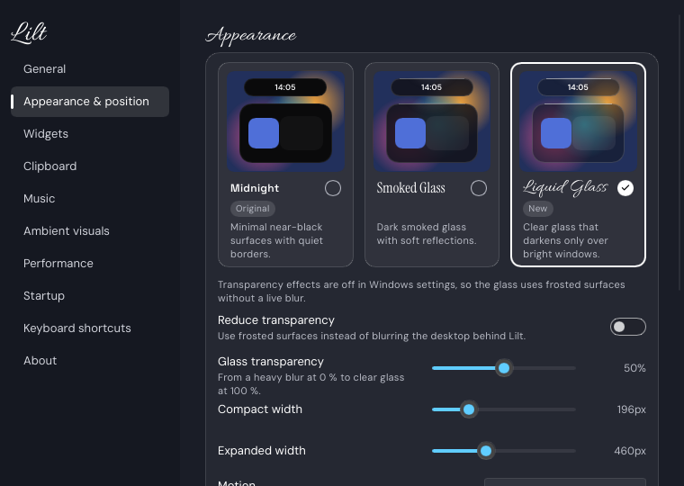
</p>
<p align="center"><sub>All three appearances and the transparency slider in <strong>Settings → Appearance & position</strong>.</sub></p>

---

## Features

### Music

Lilt follows any app that reports to Windows' media controls — Spotify, browsers, the Windows Media Player app, and more. The compact island widens to show the track name and animated playback bars. Expanding reveals the full player.

<p align="center">
  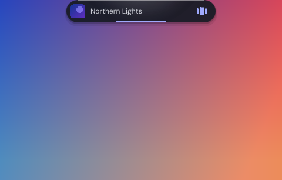
</p>
<p align="center"><sub>Compact island widened by the now-playing track — Liquid Glass.</sub></p>

<p align="center">
  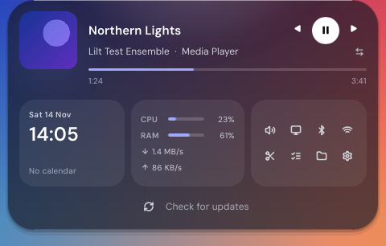
</p>
<p align="center"><sub>Expanded player with artwork, controls, timeline and system tiles.</sub></p>

**Ambient colour.** Each new album cover is analysed for its dominant hue. That hue is toned to a restrained accent: a soft glow behind the artwork, a faint wash across the panel and an accent-coloured progress bar. The intensity is adjustable.

<p align="center">
  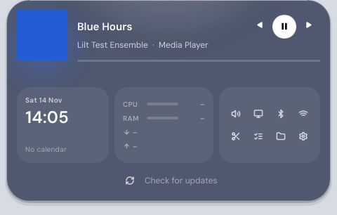
  &nbsp;
  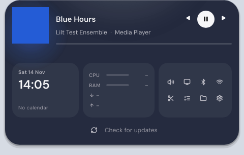
</p>
<p align="center"><sub>Ambient colour tinted from blue album art — Liquid Glass (left) and Smoked Glass (right).</sub></p>

Controls an app does not support are shown disabled; the progress bar only appears when the app reports a timeline. The **⇄** button switches between sessions when several apps are playing.

---

### Agenda

Import an `.ics` file exported from Outlook, Google Calendar or Apple Calendar to see the week ahead, with recurring events and time zones.

<p align="center">
  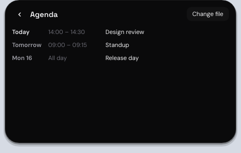
</p>
<p align="center"><sub>Agenda page showing today's and upcoming events — Midnight appearance.</sub></p>

---

### System readings

CPU load, memory use and network throughput, displayed in the main dashboard and in a dedicated detail page. Readings are sampled only while the expanded island is visible.

<p align="center">
  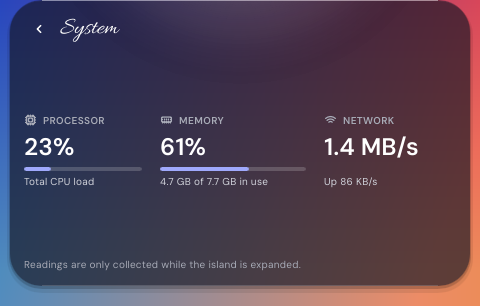
</p>
<p align="center"><sub>System detail page: total CPU load, memory in use, and current network throughput.</sub></p>

---

### Tasks

A prioritised to-do list in its own panel beside (or below) the expanded island. Quick entry, four priority levels, due dates and times, a "Focus now" card, satisfying completion tick with undo, and a searchable archive of completed work.

<table>
<tr>
<td align="center">
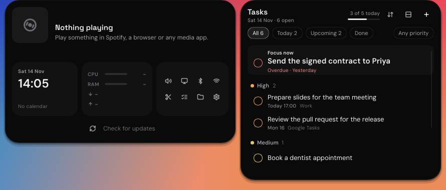<br>
<sub><strong>Midnight</strong></sub>
</td>
<td align="center">
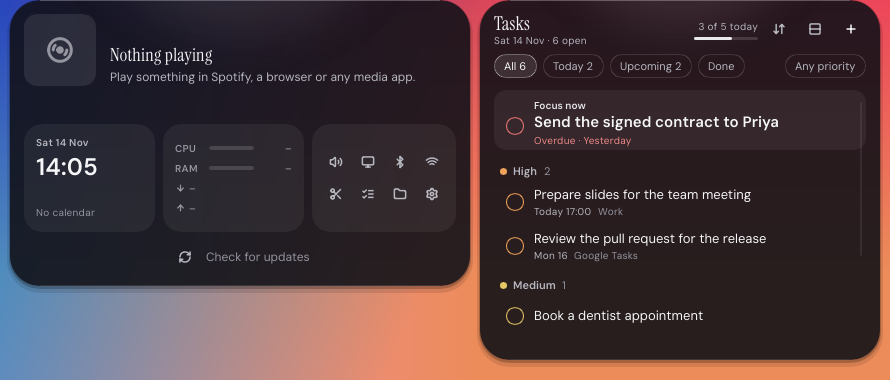<br>
<sub><strong>Smoked Glass</strong></sub>
</td>
</tr>
<tr>
<td align="center" colspan="2">
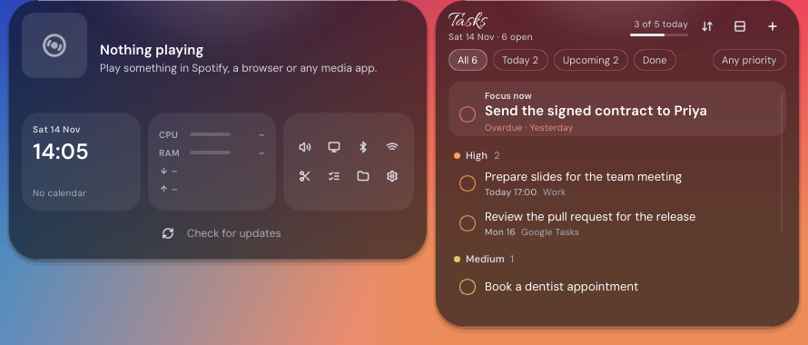<br>
<sub><strong>Liquid Glass</strong></sub>
</td>
</tr>
</table>

**Quick add** opens an inline form with priority, due date, time and category chips. No mouse required: press **N** to open it, **Tab** through the fields, **Enter** to save.

<p align="center">
  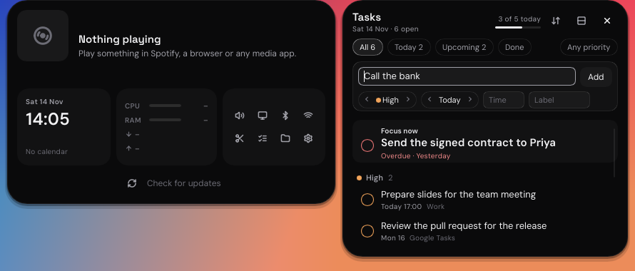
</p>
<p align="center"><sub>Inline task entry with priority and due-date chips.</sub></p>

Tasks are stored in SQLite on this PC. The tasks panel starts only when you first open it, so it costs nothing if you never use it.

---

### Clipboard shelf

Copied text you can search and copy again, pinned entries and hand-saved snippets — all stored locally. Capture is opt-in and off by default; password-manager copies and likely secrets are never kept.

<p align="center">
  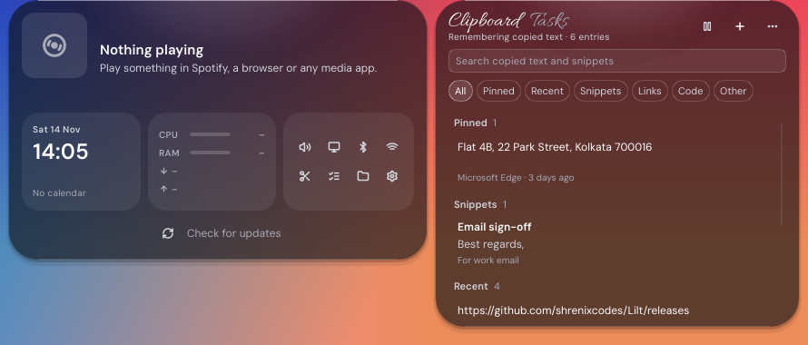
</p>
<p align="center"><sub>Clipboard shelf showing pinned, snippet and recent entries — Liquid Glass.</sub></p>

Filter by **Pinned**, **Recent**, **Snippets**, **Links**, **Code** or **Other**. Search matches text, snippet titles, descriptions and the app that copied it. Press **Enter** to copy and close the island so you can paste straight away.

---

### Quick controls

The first row of the quick-actions tile opens focused pop-ups for sound, brightness, Bluetooth and Wi-Fi.

<table>
<tr>
<td align="center">
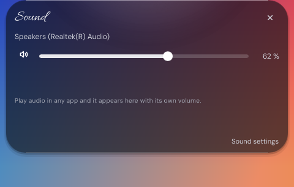<br>
<sub><strong>Sound</strong> — master volume + per-app mixer</sub>
</td>
<td align="center">
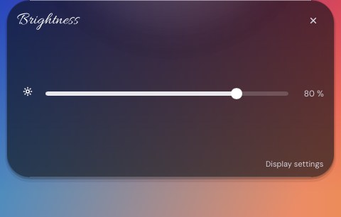<br>
<sub><strong>Brightness</strong> — built-in display control</sub>
</td>
</tr>
<tr>
<td align="center">
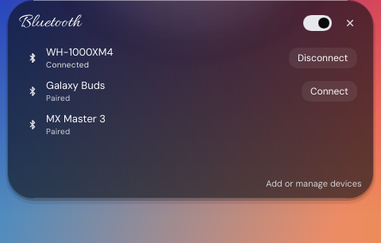<br>
<sub><strong>Bluetooth</strong> — on/off + connect/disconnect paired devices</sub>
</td>
<td align="center">
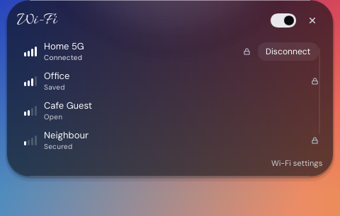<br>
<sub><strong>Wi-Fi</strong> — on/off + join networks (types password for new ones)</sub>
</td>
</tr>
</table>

The second row opens Windows Settings, the Snipping Tool, Task Manager and File Explorer.

---

### Settings

<p align="center">
  
</p>
<p align="center"><sub>Settings window — Appearance & position tab (system acrylic on Windows 11 22H2+).</sub></p>

Covers appearance, widget layout, display and position, ambient colour intensity, motion (follow Windows setting / always / reduced), low-power mode, start with Windows, and global keyboard shortcuts for the island and the clipboard shelf.

---

## Performance

Lilt is a single process with no web view. It draws on the CPU; the GPU is never used. Timers only run while their results are on screen, and all updates arrive as Windows events rather than by polling.

| State | Memory (private working set) | CPU (all 12 cores) |
| --- | ---: | ---: |
| Compact, idle — Midnight | **3.0 MB** | **0.000 %** |
| Compact, idle — Liquid Glass | **3.2 MB** | **0.000 %** |
| Compact, music playing (bars animating) | **3.5 MB** | **0.041 %** |
| Expanded with tasks box and live readings | **3.5–3.8 MB** | **0.022–0.047 %** |
| Expanded on clipboard shelf (500 entries) | **4.7 MB** | **0.000 %** |

Measured on a release build, Intel Core i5-12450H, Windows 11. No GPU activity, no network connections, no disk I/O in any state. Startup to a visible island: **0.38–0.51 s**.

[PERFORMANCE.md](PERFORMANCE.md) has the full results, test machine spec, benchmark method and historical comparison with other UI stacks.

---

## Installation

### From a release (recommended)

1. Open the [**latest release**](https://github.com/shrenixcodes/Lilt/releases/latest).
2. Download `Lilt-<version>-x64-setup.exe`.
3. Run it. Installs for your user account only — no administrator rights needed.
4. Lilt starts after installation and adds an icon to the notification area.

Each release lists the installer's SHA-256 checksum. The installer is not yet code-signed, so Windows SmartScreen may show a prompt on first run ("More info" → "Run anyway").

To uninstall: **Settings → Apps → Installed apps → Lilt**.

### Automatic updates

Lilt checks for a newer stable release on each startup. When one is available, it downloads the installer in the background, verifies its SHA-256 checksum and runs it silently. The updated version is used the next time Lilt starts.

### System requirements

- Windows 11 (64-bit) — Windows 10 version 22H2 is intended to work.
- No .NET, web view or Visual C++ redistributable.
- Integrated graphics or better. Lilt renders entirely on the CPU.

---

## Usage

| Action | How |
| --- | --- |
| Expand or collapse the island | Click it, or press **Ctrl+Alt+Space** |
| Close the expanded island | **Esc**, click outside, or move the pointer away |
| Move the island | Drag the compact island sideways |
| Add a task | Press **N** or click **+** in the tasks panel |
| Complete a task | Click its circle |
| Edit or reschedule a task | Click the task title; hover and click the clock |
| Move tasks panel | Click the layout button in its header, or *Settings → Widgets* |
| Open Settings, quit | Lilt icon in the notification area |

### Keyboard shortcuts (tasks panel)

| Key | Action |
| --- | --- |
| **N** | New task |
| **Alt+Up / Alt+Down** | Move task within its priority |
| **Ctrl+F** | Search (clipboard shelf) |
| **Enter** | Copy selected clipboard entry and close |
| **Delete** | Remove selected clipboard entry |

---

## Building from source

### Prerequisites

- Windows 10 22H2+ or Windows 11, x64
- [Rust](https://rustup.rs) stable 1.88+ with `rustfmt` and `clippy`
- MSVC toolchain (recommended) — "Desktop development with C++" in Visual Studio Build Tools  
  *or* GNU toolchain with 64-bit MinGW-w64

No Node.js, Python or other runtime is needed.

### Build

```powershell
git clone https://github.com/shrenixcodes/Lilt.git
cd Lilt
cargo build --release
```

The binary is at `target\release\lilt.exe`. Run it with:

```powershell
cargo run
```

Logs go to `%LOCALAPPDATA%\Lilt\logs\lilt.log`. Set `LILT_LOG=debug` for more detail.

### Tests

```powershell
cargo fmt --check
cargo clippy --all-targets -- -D warnings
cargo test
```

`cargo test` includes headless UI rendering tests that write images to `target\ui-snapshots\` for visual review after UI changes.

See [DEVELOPMENT.md](DEVELOPMENT.md) for the full workflow, benchmark scripts and media-session test tool. See [RELEASE.md](RELEASE.md) for packaging.

---

## Architecture

Lilt is a single Windows process. The UI runs in [Slint](https://slint.dev) with its software renderer; native Windows work is done through [`windows-rs`](https://github.com/microsoft/windows-rs). There is no async runtime.

```
┌─────────────────────────────────────────────────────────┐
│  UI thread                                              │
│  Win32 message loop → App controller → AppState/Theme   │
│                              ↓                          │
│           Slint software renderer → Layered window      │
│                                                         │
│  Timers: clock (1 min), CPU (2 s), RAM (5 s), net (1 s) │
│          only while expanded and visible                 │
└──────────────┬──────────────────┬───────────────────────┘
               │ mpsc             │ mpsc
   ┌───────────▼────────┐  ┌──────▼────────────────────┐
   │  Media thread      │  │  Clipboard thread          │
   │  GSMTC session →   │  │  WM_CLIPBOARDUPDATE →      │
   │  artwork decode →  │  │  privacy checks →          │
   │  palette extract   │  │  SQLite store              │
   └────────────────────┘  └────────────────────────────┘
   ┌────────────────────────────────────────────────────┐
   │  Controls thread (started on first pop-up open)    │
   │  Wi-Fi (Native Wifi) · Bluetooth (WinRT) ·         │
   │  Volume (Core Audio) · Brightness (WMI)            │
   └────────────────────────────────────────────────────┘
```

**Key design choices:**

- **No web view, no GPU.** A layered Win32 window presents the software-rendered bitmap. Only changed rectangles are repainted.
- **No idle loop.** `MsgWaitForMultipleObjectsEx` sleeps until input, a timer or posted work arrives. Zero wake-ups while compact and idle.
- **On-demand workers.** The controls thread starts only when a pop-up opens. The clipboard thread starts only when the shelf is first shown or capture is enabled. No resources are spent on features you don't use.
- **Event-driven media.** WinRT raises change events; the media thread only decodes artwork and posts results. Nothing is polled.
- **Lazy databases.** Tasks and clipboard entries open SQLite only on first use; bundled with the binary so no runtime is needed.

[ARCHITECTURE.md](ARCHITECTURE.md) has the complete module map, thread interactions and data flow diagram.

---

## Roadmap

The following improvements are being considered. None is committed.

- **Calendar write-back** — mark events as done, create quick entries.
- **Pomodoro / focus timer** — a countdown in the compact island.
- **Notification history** — recent Windows toast notifications in a shelf view.
- **More quick controls** — Do Not Disturb, Night Light.
- **Windows 10 verification** — full testing against 22H2 builds.
- **More sync sources** — Microsoft To Do or Todoist for the Tasks panel.

Contributions are welcome. See [Contributing](#contributing).

---

## Contributing

Issues and pull requests are welcome on [GitHub](https://github.com/shrenixcodes/Lilt).

Before submitting a pull request:

1. Run `cargo fmt`, `cargo clippy --all-targets -- -D warnings` and `cargo test`.
2. Keep changes focused; describe how you tested them.
3. New dependencies need a clear reason — resource use is a core feature of Lilt.
4. Commit messages follow [Conventional Commits](https://www.conventionalcommits.org) (`feat(media): …`, `fix(window): …`, `perf(ui): …`).

---

## Privacy

Lilt has no telemetry and no accounts. At startup it makes one HTTPS request to the GitHub Releases API to check for updates. Media information is only displayed, never stored or transmitted. Tasks and clipboard entries are stored on this PC only. Details are in [SECURITY.md](SECURITY.md).

---

## License

Lilt is released under the [MIT License](LICENSE).

Its interface is built with [Slint](https://slint.dev), used under the Slint Royalty-free License. Icons are from [Lucide](https://lucide.dev). Bundled fonts (DM Sans, Space Grotesk, Instrument Serif, Allura, JetBrains Mono) are under the [SIL Open Font License](assets/fonts/). See [THIRD-PARTY-NOTICES.md](THIRD-PARTY-NOTICES.md) for all acknowledgements.

<p align="center">
  <a href="https://slint.dev"></a>
</p>

---

<p align="center"><sub>Screenshots rendered from Lilt's real interface by its UI test suite.</sub></p>
